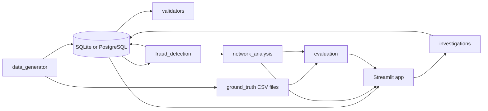
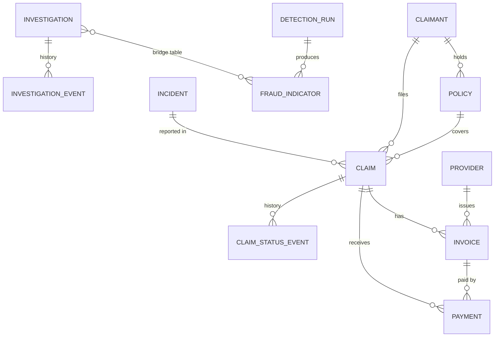

import pypandoc

readme = r'''# Insurance Fraud Network Detection and Investigation System

A working investigation-support tool that links claimants, policies, claims, incidents, providers, invoices, and payments; flags suspicious networks using explainable rules; and allows analysts to record investigation decisions.

A high score means **review recommended**, never "fraud proven".

All data is synthetic and generated locally using a fixed seed. No real personal data is used.

## Live Demo

**Live Application:** [Open Insurance Fraud Network Detection](https://insurance-fraud-network.streamlit.app/)

The application is deployed using Streamlit Community Cloud. Reviewers can explore the dashboard, investigate potentially suspicious claims, analyze relationships between entities, and examine model evaluation results.

### How to Access the Live Application

1. Open the [live application](https://insurance-fraud-network.streamlit.app/).
2. Wait for the application to finish loading. If Streamlit displays a wake-up or loading screen after inactivity, follow the on-screen instructions and wait for the application to start.
3. Explore the dashboard and the available analysis pages using the application's navigation.
4. Open **Claims Explorer** to examine individual claims and their details.
5. Open **Network Analysis** to investigate relationships between claimants, providers, policies, and claims.
6. Explore **Fraud Indicators & Exceptions** to understand the rules that flag suspicious activity and data-quality issues.
7. Open **Evaluation** to review the detection metrics against the synthetic answer key.
8. Open **Investigation Workspace** to explore the investigation workflow. Viewing the dashboard does not require sign-in; recording investigation decisions requires the configured application access credentials.

### Passcode:Dheeraj@04

### Demo Notes

- The application uses synthetic insurance data and does not process real customer information.
- Detection scores indicate cases recommended for review, not confirmed fraud.
- Evaluation metrics measure performance against planted patterns in synthetic data and should not be interpreted as real-world fraud-detection performance.
- The hosted application uses the database and configuration available in its deployment environment.
- If the hosted application is temporarily unavailable, use the screenshots below and follow the local setup instructions to run the project.
- If investigation access requires a passcode, obtain the designated demo credentials from the project owner. Do not publish database credentials, API keys, or production secrets in this README.

## Screenshots

### Overview


### Claims Explorer


### Network Analysis


### Evaluation


## Features

- **Deterministic data generator:** Seed `20261022`; full mode generates 5,000 claims, 2,000 claimants, 500 providers, and 8,000 relationship edges.
- **Data validation:** Checks keys, foreign keys, enumerations, date ordering, lifecycles, and monetary reconciliation. Planted anomalies are reported as expected.
- **Explainable fraud indicators:** Rules identify suspicious patterns and provide evidence for analyst review.
- **Network analysis:** Uses NetworkX to construct relationship graphs and rank suspicious networks.
- **Interactive dashboard:** Includes Overview, Claims Explorer, Network Analysis, Fraud Indicators & Exceptions, Investigation Workspace, and Evaluation.
- **Investigation history:** Stores investigation decisions and events in the configured database.
- **Evaluation:** Measures detection against an isolated synthetic answer key using precision, recall, F1, false-positive rate, false-negative rate, and precision at K.
- **Dual database support:** One codebase supports local SQLite and hosted PostgreSQL on Neon.

See `DEPLOYMENT.md` for hosted deployment details.

## Architecture



The detector reads database tables only. The evaluation module reads the answer-key files after detection to assess the results. The answer key is not used as an input to the detection rules.

## Entity Relationships



The `relationship_edges` table links claimants, providers, policies, and claims polymorphically. These relationships are checked by validation code rather than conventional foreign-key constraints.

For more information, see `docs/data_dictionary.md` and `docs/schema.md`.

## Technology Stack

- Python 3.11
- Streamlit
- pandas
- NetworkX
- Plotly
- SQLAlchemy Core
- SQLite for local execution
- PostgreSQL on Neon for hosted deployment
- PyYAML
- pytest

No LLM or paid API is required to run the application.

## Local Setup

### Prerequisites

- Python 3.11
- Git

### macOS / Linux

```bash
git clone https://github.com/dheerajreddysaddi/insurance-fraud-network-detection.git
cd insurance-fraud-network-detection

python3.11 -m venv .venv
source .venv/bin/activate

python -m pip install -r requirements.txt
cp .env.example .env
```

### Windows (PowerShell)

```powershell
git clone https://github.com/dheerajreddysaddi/insurance-fraud-network-detection.git
cd insurance-fraud-network-detection

py -3.11 -m venv .venv
.venv\Scripts\Activate.ps1

python -m pip install -r requirements.txt
copy .env.example .env
```

### Environment Configuration

Edit `.env`:

- Leave `DATABASE_URL` empty to use local SQLite.
- Set `APP_PASSCODE` to a local passcode of your choice.

Always use `python -m ...` commands from the activated virtual environment to ensure that the correct Python interpreter is used.

Never commit `.env` or any file containing real credentials.

## Run the Application

From the repository root, with the virtual environment activated:

```bash
python scripts/generate_data.py --scale full --replace
python scripts/validate_data.py
python scripts/run_detection.py
python -m streamlit run app.py
```
### Screenshots


The commands perform the following operations:

1. Generate the full synthetic dataset and replace existing generated data.
2. Validate data integrity and write `docs/validation_summary.md`.
3. Run fraud detection, save indicators, and print evaluation results.
4. Start the Streamlit application.

Open the local URL displayed in the terminal, usually `http://localhost:8501`.

Use the application sidebar to sign in with a name and the configured `APP_PASSCODE` to access investigation functionality. Dashboard viewing does not require sign-in.

**Warning:** The `--replace` option replaces generated data. Review the available options and back up any records you need to preserve before regenerating data.

## Tests, Exports, and Reproducibility

Run the automated test suite:

```bash
python -m pytest -v
```

Export generated data:

```bash
python scripts/export_data.py --scale full
```

Exports are written to `data/generated/` in CSV, JSON, and SQL formats.

Verify reproducibility:

```bash
python scripts/verify_reproducibility.py
```

This command compares SHA-256 hashes across two separate generation runs.

Regenerate the documentation:

```bash
python scripts/build_docs.py
```

The generated CSV, JSON, SQL, and ground-truth files are designed to be byte-for-byte reproducible for a fixed seed and configuration. Detection run IDs, timestamps, validation timestamps, and investigation records are not expected to be reproducible.

## Fraud Rules and Scoring

Rules are configured in `config/detection_rules.yaml`.

| Indicator | Category | Score | Rule |
|---|---|---:|---|
| `SHARED_PHONE` / `SHARED_EMAIL` | Suspicious | 30 + 5 per extra member, maximum 45 | Shared by claimants at different addresses |
| `SIMILAR_NARRATIVE` | Suspicious | 30 + 5 per claim, maximum 60 | Word-set similarity of at least 0.85 across different claimants |
| `DUPLICATE_INVOICE_ACROSS_CLAIMANTS` | Suspicious | 50 | Same fingerprint or provider reference across different claimants |
| `UNUSUAL_TIMING` | Suspicious | 10 | At least two conditions: incident within 30 days after policy start, filing within one day, or payment within one day |
| `REPEAT_CLAIMANT_PROVIDER` | Suspicious | 5 | Same claimant and provider within 60 days; weak indicator |
| `PAYMENT_EXCEEDS_APPROVED` | Exception | 20–40 | Payment exceeds the approved amount |
| `DATA_INTEGRITY_VIOLATION` | Exception | 20–40 | Data integrity problem |
| `MISSING_RELATIONSHIP_EDGE` | Exception | 20–40 | Expected relationship edge is missing |
| `BENIGN_SHARED_ADDRESS` | Benign | 0 | Shared household address; does not create a suspicious network link |

Exception indicators are reported separately and do not contribute to the fraud-risk score.

A claim is flagged when its score is at least 40 or when its claimant belongs to a flagged network.

A network is flagged when its score is at least 80 and it has at least two distinct indicator types.

See `DESIGN_DECISIONS.md` for the rationale behind the scoring thresholds and design trade-offs.

## Evaluation

Evaluation uses the claim as the unit of analysis. The full synthetic dataset contains 5,000 claims, including 46 claims in planted networks.

The claim-level metrics are defined as follows:

- **Precision:** TP / (TP + FP)
- **Recall:** TP / (TP + FN)
- **F1:** Harmonic mean of precision and recall
- **False-positive rate (FPR):** FP / (FP + TN)
- **False-negative rate (FNR):** FN / (FN + TP)

For network-level evaluation, a flagged network is considered true if at least half of its claimants belong to one planted network. Precision at K (P@K) measures the proportion of the top K ranked networks that are true.

No train/test split is used because the system does not train a predictive model.

### Results with the Default Seed

The following results are documented for seed `20261022` using the shipped rules and the output of `scripts/run_detection.py`.

| Method | TP | FP | FN | TN | Precision | Recall | F1 | FPR |
|---|---:|---:|---:|---:|---:|---:|---:|---:|
| Rules only | 30 | 32 | 16 | 4,922 | 0.484 | 0.652 | 0.556 | 0.006 |
| Rules + network | 46 | 222 | 0 | 4,732 | 0.172 | 1.000 | 0.293 | 0.045 |

### Network-Level Results

- Planted networks: 6
- Planted networks recovered: 6
- Networks flagged: 12
- True flagged networks: 6
- False flagged networks: 6
- Network precision: 0.500
- P@5: 0.800
- P@6: 0.667

With seed `777` and unchanged rules, the rules-plus-network method achieved precision of 0.127 and an FPR of 0.064. Thirteen networks were flagged, seven of which were false, while all six planted networks were recovered.

These results compare rules against synthetic labels generated by the same author. They do not demonstrate real-world fraud-detection performance.

## Known Limitations

- Claim-level precision is low (approximately 0.13–0.17 for the rules-plus-network method) because every claim belonging to a member of a flagged network is flagged.
- Thresholds were chosen with knowledge of the data generator, so evaluation results are optimistic.
- The narrative vocabulary is limited, which can produce coincidental matches.
- Sign-in uses a shared passcode, and reviewer names are self-declared. This is a demonstration workflow, not production-grade identity management.
- Automated tests run on SQLite only. PostgreSQL compatibility is checked using the manual procedure in `DEPLOYMENT.md`.
- Synthetic labels represent injected patterns, not confirmed fraud.
- The system supports investigation and prioritization; it does not establish fraud or replace human review.

## AI Usage and Data Provenance

See:

- `AI_USAGE.md` for AI assistance and prompt history.
- `docs/source_manifest.md` for data provenance.

AI tools were used as part of the development process. The project documentation describes the assistance used and the decisions, implementation, review, and validation undertaken during development.

## Deployment

The hosted application uses Streamlit Community Cloud and PostgreSQL on Neon.

See `DEPLOYMENT.md` for environment variables, database configuration, persistence checks, and deployment acceptance tests.

For reviewer access to the live application, use the link in the [Live Demo](#-live-demo) section above.

## Troubleshooting

| Problem | Suggested fix |
|---|---|
| `ModuleNotFoundError` for an installed package | Activate the virtual environment and run `python -m pip install -r requirements.txt`. Use `python -m streamlit run app.py` to launch the app. |
| `pyarrow requires NumPy 2.0` | Install dependencies using the pinned versions in `requirements.txt`, including `pyarrow==17.0.0` if that is the version specified in your file. |
| Red "No secrets found" message or missing passcode field | For local execution, create `.env` from `.env.example`, configure the required values, and restart the application. Hosted configuration must be set in the deployment environment. |
| Incorrect passcode | Check the configured `APP_PASSCODE`. Restart the local application after changing `.env`. |
| Port 8501 is busy and Streamlit switches to another port | Stop the old process or use the alternative local URL displayed by Streamlit. On macOS/Linux, inspect the relevant port with `lsof -i :8501`. |
| Database already contains data | Review the generator's options and use `--replace` only when replacing existing generated data is intended. If investigations exist, review `--wipe-investigations` carefully because it erases them. |
| PowerShell blocks virtual environment activation | Run `Set-ExecutionPolicy -Scope CurrentUser RemoteSigned` if appropriate for your environment, or consult your organization's execution-policy guidance. |
| Live demo takes time to open | Wait for Streamlit Community Cloud to finish waking the application. Refresh once if necessary. |
| Live demo does not load | Check the deployment status and logs, environment variables, database connectivity, and configured secrets in Streamlit Community Cloud. |

