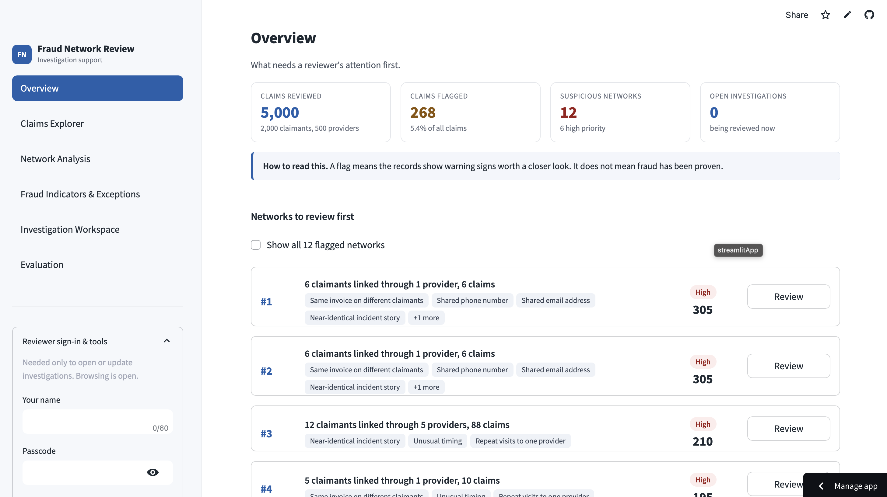
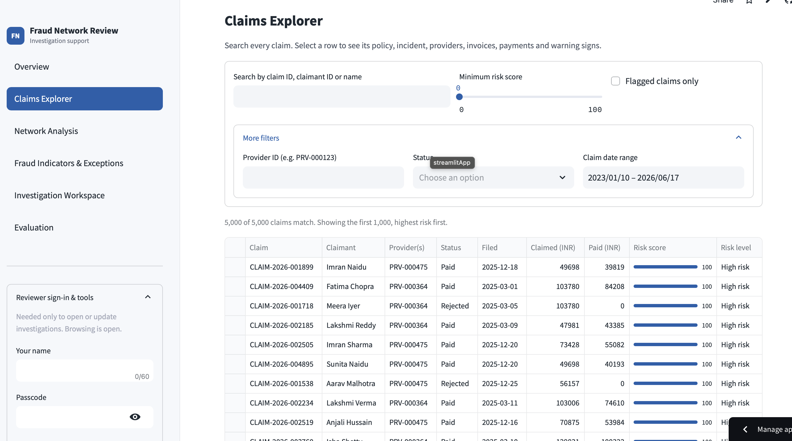
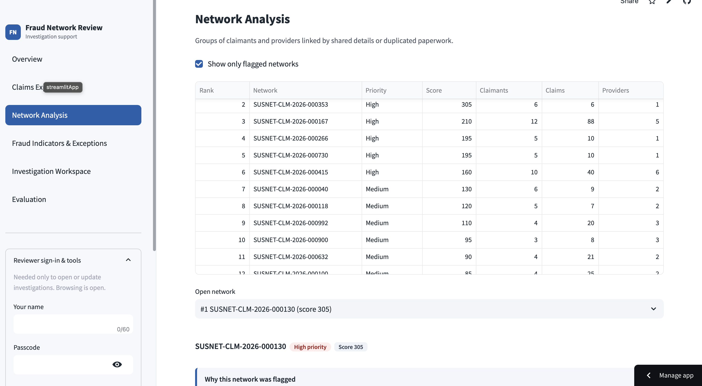
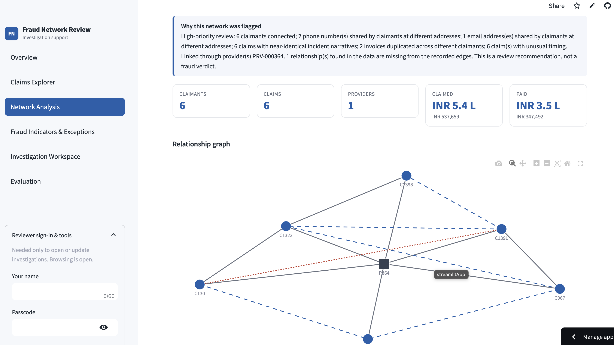
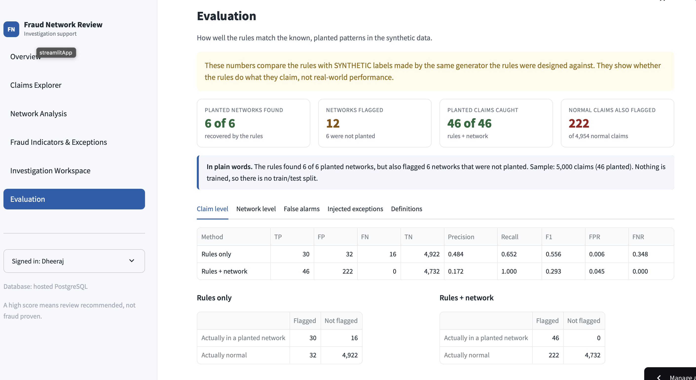
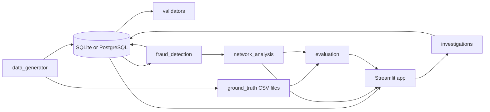
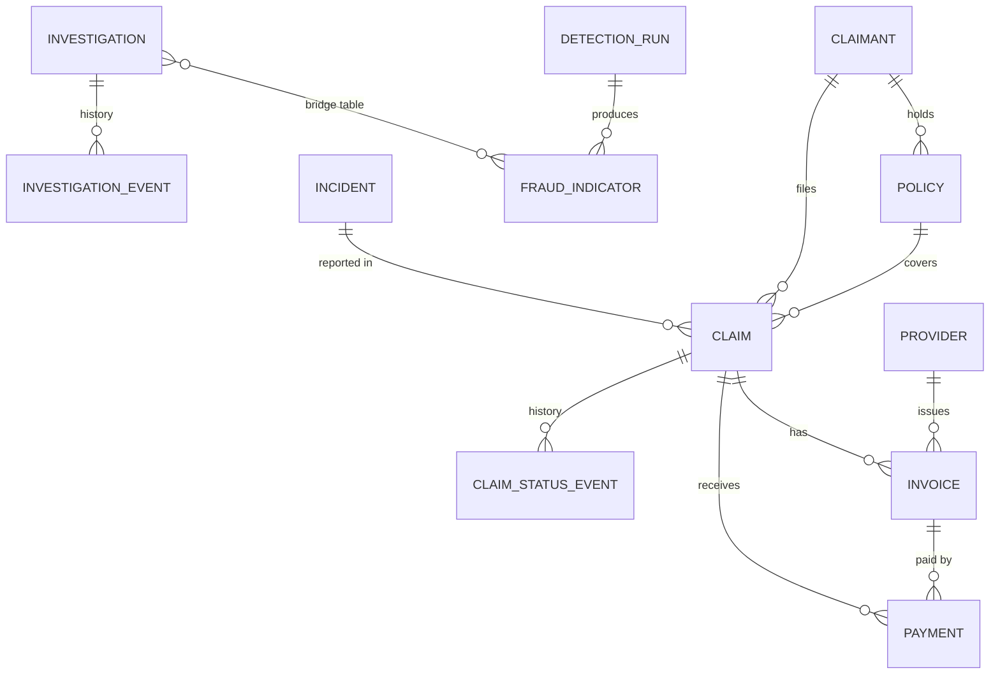

# Insurance Fraud Network Detection and Investigation System

A working investigation-support tool: it links claimants, policies, claims, incidents, providers, invoices and
payments, flags suspicious networks with explainable rules, and lets an analyst record investigation decisions.
A high score means **review recommended**, never "fraud proven".

All data is synthetic, generated locally with a fixed seed. No real personal data is used.






## Features
- Deterministic generator (seed `20261022`): 5,000 claims, 2,000 claimants, 500 providers, 8,000 relationship edges (full mode).
- Validation: keys, foreign keys, enums, date order, lifecycles, money reconciliation. Planted anomalies are reported as *expected*.
- Explainable indicators, a NetworkX relationship graph, ranked suspicious networks.
- Streamlit dashboard: Overview, Claims Explorer, Network Analysis, Fraud Indicators & Exceptions, Investigation Workspace, Evaluation.
- Append-only investigation history, saved in the database.
- Evaluation against an isolated answer key (precision, recall, F1, FPR, FNR, precision@K).
- One codebase, two modes: local SQLite, or hosted PostgreSQL (Neon). See `DEPLOYMENT.md`.

## Architecture

The detector reads database tables only. Only `evaluation.py` reads the answer-key files, after detection.

## Entity relationships

`relationship_edges` links claimants, providers, policies and claims polymorphically, so it is checked by validation code
rather than foreign keys. Full details: `docs/data_dictionary.md`, `docs/schema.md`.

## Technology
Python 3.11, Streamlit, pandas, NetworkX, Plotly, SQLAlchemy Core, SQLite (local) / PostgreSQL on Neon (hosted),
PyYAML, pytest. No LLM or paid API is needed to run anything.

## Setup
Requires Python 3.11 and Git.

**macOS / Linux**
```bash
git clone https://github.com/dheerajreddysaddi/insurance-fraud-network-detection.git
cd insurance-fraud-network-detection
python3.11 -m venv .venv
source .venv/bin/activate
python -m pip install -r requirements.txt
cp .env.example .env
```
**Windows (PowerShell)**
```powershell
git clone https://github.com/dheerajreddysaddi/insurance-fraud-network-detection.git
cd insurance-fraud-network-detection
py -3.11 -m venv .venv
.venv\Scripts\Activate.ps1
python -m pip install -r requirements.txt
copy .env.example .env
```
Edit `.env`: leave `DATABASE_URL` empty for local SQLite and set `APP_PASSCODE` to any value. Always use `python -m ...` so the
venv's Python is used.

## Run
```bash
python scripts/generate_data.py --scale full --replace   # load data (use --scale starter for a quick demo)
python scripts/validate_data.py                          # writes docs/validation_summary.md
python scripts/run_detection.py                          # saves indicators and prints evaluation
python -m streamlit run app.py                           # http://localhost:8501
```
Sign in from the sidebar with any name and your `APP_PASSCODE` to open investigations. Viewing needs no sign-in.

## Tests, exports, reproducibility
```bash
python -m pytest -v
python scripts/export_data.py --scale full               # CSV, JSON, seed.sql into data/generated/
python scripts/verify_reproducibility.py                 # two separate runs, compares SHA-256 of every file
python scripts/build_docs.py                             # regenerates the data dictionary and schema docs
```
Byte-for-byte reproducible: all CSV, JSON, SQL and ground-truth files. Not reproducible by design: detection run IDs and
timestamps, validation timestamps and investigation records.

## Fraud rules and scoring (`config/detection_rules.yaml`)
| Indicator | Category | Score | Rule |
|---|---|---:|---|
| SHARED_PHONE / SHARED_EMAIL | suspicious | 30 + 5 per extra member, max 45 | shared by claimants at **different** addresses |
| SIMILAR_NARRATIVE | suspicious | 30 + 5 per claim, max 60 | word-set similarity >= 0.85 across different claimants |
| DUPLICATE_INVOICE_ACROSS_CLAIMANTS | suspicious | 50 | same fingerprint or provider reference on different claimants |
| UNUSUAL_TIMING | suspicious | 10 | at least 2 of: incident <= 30 days after policy start, filed <= 1 day, paid <= 1 day |
| REPEAT_CLAIMANT_PROVIDER | suspicious | 5 | same claimant and provider within 60 days (weak) |
| PAYMENT_EXCEEDS_APPROVED, DATA_INTEGRITY_VIOLATION, MISSING_RELATIONSHIP_EDGE | exception | 20-40 | reported separately, **not** fraud-risk |
| BENIGN_SHARED_ADDRESS | benign | 0 | households; creates no network link |

A claim is flagged at score >= 40 or when its claimant is in a flagged network. A network is flagged at score >= 80 with at
least 2 distinct indicator types. See `DESIGN_DECISIONS.md`.

## Evaluation
Claim level (unit = claim, n = 5,000, 46 in planted networks): TP, FP, FN, TN, precision = TP/(TP+FP), recall = TP/(TP+FN),
F1, FPR = FP/(FP+TN), FNR = FN/(FN+TP). Network level: a flagged network is true if at least half its claimants come from one
planted network; P@K is the share of the top K networks that are true. There is no train/test split because nothing is trained.

Results with the default seed and shipped rules (from `scripts/run_detection.py`):

| Method | TP | FP | FN | TN | Precision | Recall | F1 | FPR |
|---|---:|---:|---:|---:|---:|---:|---:|---:|
| Rules only | 30 | 32 | 16 | 4922 | 0.484 | 0.652 | 0.556 | 0.006 |
| Rules + network | 46 | 222 | 0 | 4732 | 0.172 | 1.000 | 0.293 | 0.045 |

Networks: 6 planted, 6 recovered, 12 flagged (6 true, 6 false), precision 0.500, P@5 0.800, P@6 0.667.
With seed 777 and unchanged rules: rules + network precision 0.127, FPR 0.064, 13 networks flagged (7 false); all 6 planted
networks were still recovered. These compare the rules with synthetic labels made by the same author, so they do not
show real-world fraud-detection performance.


## Known limitations
- Claim-level precision is low (0.13-0.17) because every claim of every member of a flagged network is flagged.
- Thresholds were chosen with knowledge of the generator; results are optimistic. Narrative vocabulary is small, so some
  coincidental matches occur.
- Sign-in is one shared passcode and the reviewer name is self-declared.
- Automated tests run on SQLite only; PostgreSQL is checked by the manual procedure in `DEPLOYMENT.md`.
- Synthetic labels show injected patterns, not proven fraud.

## AI usage and data provenance
See `AI_USAGE.md` and `docs/source_manifest.md`.

## Troubleshooting
| Problem | Fix |
|---|---|
| `ModuleNotFoundError` for an installed package | Wrong Python. Run `python -m streamlit ...` and `python -m pip ...` from the activated venv; check `which python`. |
| `pyarrow requires NumPy 2.0` | Use the pinned `requirements.txt` (`pyarrow==17.0.0`). |
| Red "No secrets found" box, or no Passcode field | Create `.env` from `.env.example`, then restart the app. |
| Wrong passcode | It is the `APP_PASSCODE` value in `.env` (restart after editing). |
| Port 8501 busy, app moves to 8502+ | Stop old servers: `lsof -i :8501-8510`, then `kill -9 <PID>`. |
| "database already contains data" | Add `--replace`; if investigations exist also `--wipe-investigations` (erases them). |
| PowerShell blocks activation | `Set-ExecutionPolicy -Scope CurrentUser RemoteSigned` |