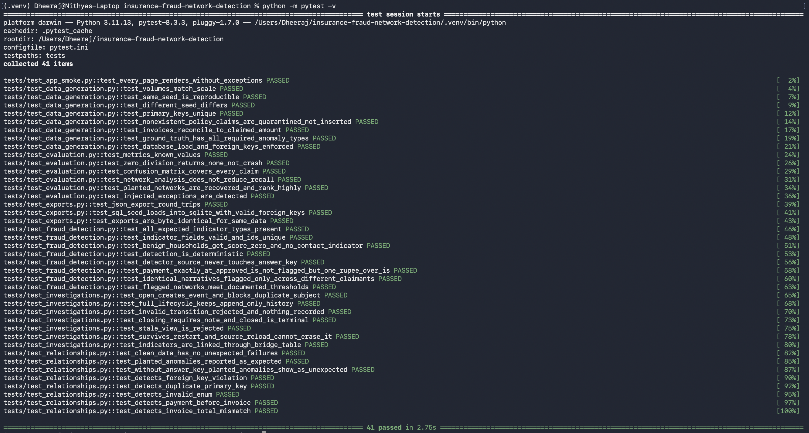
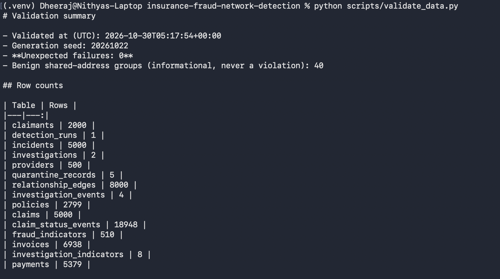
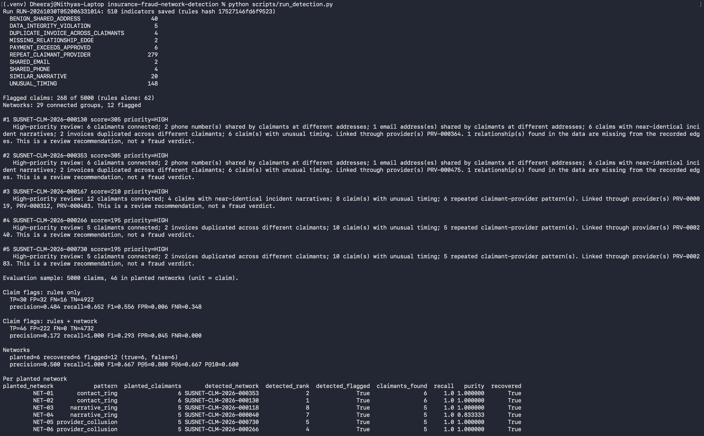
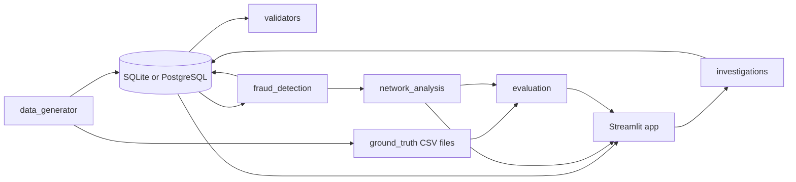
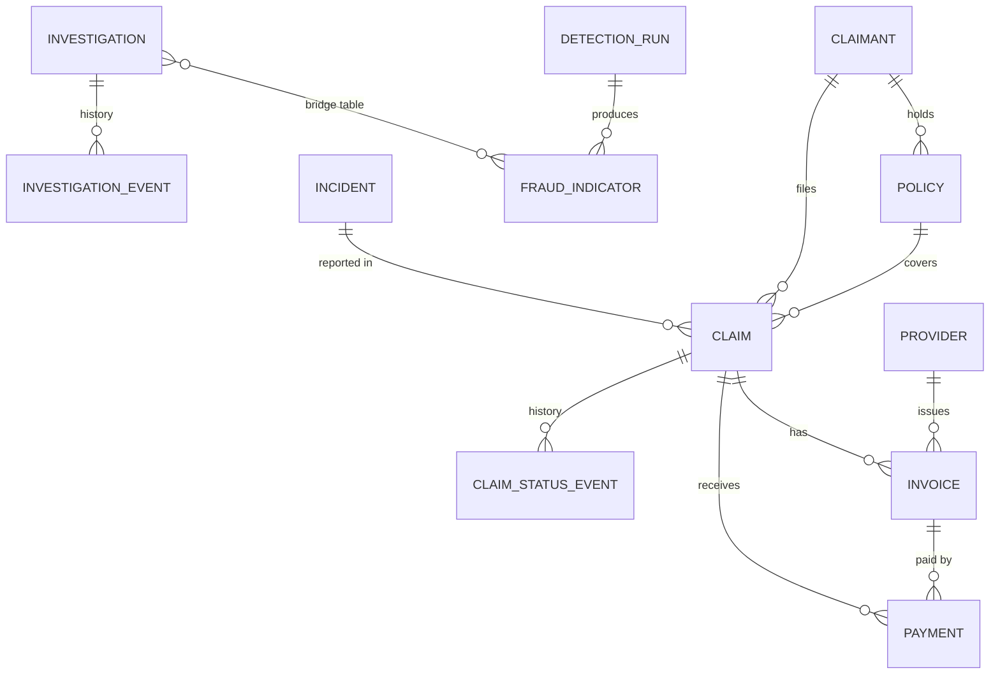

# Insurance Fraud Network Detection and Investigation System

A working investigation-support tool that links claimants, policies, claims, incidents, providers, invoices, and payments; flags suspicious networks using explainable rules; and lets analysts record investigation decisions.

A high score means **review recommended**, never "fraud proven".

All data is synthetic and generated locally using a fixed seed. No real personal data is used.

## Live Demo

**Live application:** [insurance-fraud-network.streamlit.app](https://insurance-fraud-network.streamlit.app/)

The app runs on Streamlit Community Cloud with a PostgreSQL database on Neon.

### How to explore it

1. Open the live application. If it was idle, Streamlit may show a wake-up screen; wait for it to start.
2. **Overview:** see the networks that need review first.
3. **Claims Explorer:** search any claim and open its policy, incident, providers, invoices, payments and warning signs.
4. **Network Analysis:** open a network to see its graph, connections and evidence.
5. **Fraud Indicators & Exceptions:** see every rule hit, with the rule and evidence behind it.
6. **Evaluation:** compare the rules with the synthetic answer key.
7. **Investigation Workspace:** review the investigation workflow.

Browsing needs no sign-in. Opening or updating investigations needs a reviewer name and the demo passcode, which the project owner shares privately with reviewers. It is not published in this repository.

### Demo notes

- The data is synthetic; no real customer information is processed.
- Scores mean "review recommended", not confirmed fraud.
- Evaluation metrics measure performance against patterns planted in synthetic data, not real-world fraud detection.
- If the hosted app is unavailable, use the screenshots below and the local setup instructions.

## Screenshots

### Overview


### Claims Explorer


### Network Analysis


### Evaluation


### Verification runs






## Features

- **Deterministic data generator:** seed `20261022`; full mode creates 5,000 claims, 2,000 claimants, 500 providers and 8,000 relationship edges.
- **Data validation:** keys, foreign keys, enumerations, date ordering, lifecycles and money reconciliation. Planted anomalies are reported as expected.
- **Explainable indicators:** rules flag suspicious patterns and provide evidence for review.
- **Network analysis:** NetworkX relationship graphs and ranked suspicious networks.
- **Dashboard:** Overview, Claims Explorer, Network Analysis, Fraud Indicators & Exceptions, Investigation Workspace and Evaluation.
- **Investigation history:** decisions and events are stored in the configured database and never overwritten.
- **Evaluation:** precision, recall, F1, false-positive rate, false-negative rate and precision at K against an isolated synthetic answer key.
- **Two database modes:** one codebase supports local SQLite and hosted PostgreSQL on Neon.

## Architecture



The detector reads database tables only. Only the evaluation module reads the answer-key files, after detection.

## Entity relationships



`relationship_edges` links claimants, providers, policies and claims polymorphically, so it is checked by validation code rather than foreign keys. Details: `docs/data_dictionary.md` and `docs/schema.md`.

## Technology

Python 3.11, Streamlit, pandas, NetworkX, Plotly, SQLAlchemy Core, SQLite (local), PostgreSQL on Neon (hosted), PyYAML, pytest. No LLM or paid API is needed to run anything.

## Local setup

Requires Python 3.11 (newer versions will fail to install the pinned packages) and Git.

**macOS / Linux**
```bash
git clone https://github.com/dheerajreddysaddi/insurance-fraud-network-detection.git
cd insurance-fraud-network-detection
python3.11 -m venv .venv
source .venv/bin/activate
python -m pip install -r requirements.txt
cp .env.example .env
```

**Windows (PowerShell)**
```powershell
git clone https://github.com/dheerajreddysaddi/insurance-fraud-network-detection.git
cd insurance-fraud-network-detection
py -3.11 -m venv .venv
.venv\Scripts\Activate.ps1
python -m pip install -r requirements.txt
copy .env.example .env
```

Edit `.env`: leave `DATABASE_URL` empty to use local SQLite, and set `APP_PASSCODE` to a passcode of your choice. Always run `python -m ...` from the activated virtual environment. Never commit `.env` or any file containing real credentials.

## Run

```bash
python scripts/generate_data.py --scale full --replace   # load data
python scripts/validate_data.py                          # writes docs/validation_summary.md
python scripts/run_detection.py                          # saves indicators, prints evaluation
python -m streamlit run app.py                           # http://localhost:8501
```

Sign in from the sidebar with any name and your `APP_PASSCODE` to open investigations. Viewing needs no sign-in.

**Warning:** `--replace` rebuilds the generated data. If investigations exist, the script refuses unless you also pass `--wipe-investigations`, which erases them.

## Tests, exports, reproducibility

```bash
python -m pytest -v                          # 41 tests
python scripts/export_data.py --scale full   # CSV, JSON and seed.sql in data/generated/
python scripts/verify_reproducibility.py     # two separate runs, compares SHA-256 of every file
python scripts/build_docs.py                 # regenerates the data dictionary and schema docs
```

Generated CSV, JSON, SQL and ground-truth files are byte-for-byte reproducible for a fixed seed. Detection run IDs, timestamps and investigation records are not.

## Fraud rules and scoring

Rules live in `config/detection_rules.yaml`.

| Indicator | Category | Score | Rule |
|---|---|---:|---|
| `SHARED_PHONE` / `SHARED_EMAIL` | Suspicious | 30 + 5 per extra member, max 45 | Shared by claimants at different addresses |
| `SIMILAR_NARRATIVE` | Suspicious | 30 + 5 per claim, max 60 | Word-set similarity of at least 0.85 across different claimants |
| `DUPLICATE_INVOICE_ACROSS_CLAIMANTS` | Suspicious | 50 | Same fingerprint or provider reference across different claimants |
| `UNUSUAL_TIMING` | Suspicious | 10 | At least two of: incident within 30 days of policy start, filed within one day, paid within one day |
| `REPEAT_CLAIMANT_PROVIDER` | Suspicious | 5 | Same claimant and provider within 60 days (weak) |
| `PAYMENT_EXCEEDS_APPROVED`, `DATA_INTEGRITY_VIOLATION`, `MISSING_RELATIONSHIP_EDGE` | Exception | 20-40 | Reported separately, not added to fraud-risk scores |
| `BENIGN_SHARED_ADDRESS` | Benign | 0 | Households; creates no network link |

A claim is flagged at a score of 40 or more, or when its claimant belongs to a flagged network. A network is flagged at a score of 80 or more with at least two distinct indicator types. Rationale and trade-offs: `DESIGN_DECISIONS.md`.

## Evaluation

The unit is the claim: 5,000 claims, 46 of them in planted networks.

- **Precision** = TP / (TP + FP)
- **Recall** = TP / (TP + FN)
- **F1** = harmonic mean of precision and recall
- **FPR** = FP / (FP + TN)
- **FNR** = FN / (FN + TP)

At network level, a flagged network is true if at least half its claimants come from one planted network. P@K is the share of the top K ranked networks that are true. Nothing is trained, so there is no train/test split.

### Results (default seed, shipped rules)

| Method | TP | FP | FN | TN | Precision | Recall | F1 | FPR |
|---|---:|---:|---:|---:|---:|---:|---:|---:|
| Rules only | 30 | 32 | 16 | 4,922 | 0.484 | 0.652 | 0.556 | 0.006 |
| Rules + network | 46 | 222 | 0 | 4,732 | 0.172 | 1.000 | 0.293 | 0.045 |

Networks: 6 planted, 6 recovered, 12 flagged (6 true, 6 false), precision 0.500, P@5 0.800, P@6 0.667.

With seed `777` and unchanged rules, rules + network precision was 0.127 and FPR 0.064; 13 networks were flagged (7 false), and all 6 planted networks were still recovered.

These compare the rules with synthetic labels made by the same author. They do not show real-world fraud-detection performance.

## Known limitations

- Claim-level precision is low (about 0.13-0.17 with the network step) because every claim of every member of a flagged network is flagged.
- Thresholds were chosen with knowledge of the generator, so results are optimistic.
- The narrative vocabulary is small, which can produce coincidental matches.
- Sign-in uses one shared passcode and self-declared reviewer names. This is a demo control, not production identity management.
- Automated tests run on SQLite only; PostgreSQL is checked by the manual procedure in `DEPLOYMENT.md`.
- Synthetic labels show injected patterns, not proven fraud.
- The system supports prioritization and review; it does not establish fraud.

## AI usage and data provenance

See:

AI_USAGE.md for AI assistance and prompt history.

docs/source_manifest.md for data provenance.

AI tools were used as part of the development process. The project documentation describes the assistance used and the decisions, implementation, review, and validation undertaken during development.

## Deployment

The hosted app uses Streamlit Community Cloud and PostgreSQL on Neon, with the database URL and passcode stored as platform secrets, never in the repository. See `DEPLOYMENT.md` for the steps, persistence checks and acceptance tests. For the live app, see the [Live Demo](#live-demo) section.

## Troubleshooting

| Problem | Fix |
|---|---|
| `ModuleNotFoundError` for an installed package | Wrong Python. Activate `.venv`, run `python -m pip install -r requirements.txt`, and start the app with `python -m streamlit run app.py`. |
| `pyarrow requires NumPy 2.0` | Install from the pinned `requirements.txt` (`pyarrow==17.0.0`). |
| Red "No secrets found" box, or no Passcode field | Create `.env` from `.env.example`, then restart the app. |
| Wrong passcode | It is the `APP_PASSCODE` value in `.env`; restart after editing. |
| Port 8501 busy, app moves to 8502+ | `lsof -i :8501-8510`, then `kill -9 <PID>`. Stop apps with Ctrl-C, not Ctrl-Z. |
| "database already contains data" | Add `--replace`; if investigations exist also `--wipe-investigations` (erases them). |
| PowerShell blocks activation | `Set-ExecutionPolicy -Scope CurrentUser RemoteSigned` |
| Hosted build fails on numpy, pandas or psycopg2 | Python version. Recreate the app with Python 3.11 under Advanced settings. |
| Hosted app slow after idle | Streamlit is waking the app and Neon is resuming; wait and refresh once. |